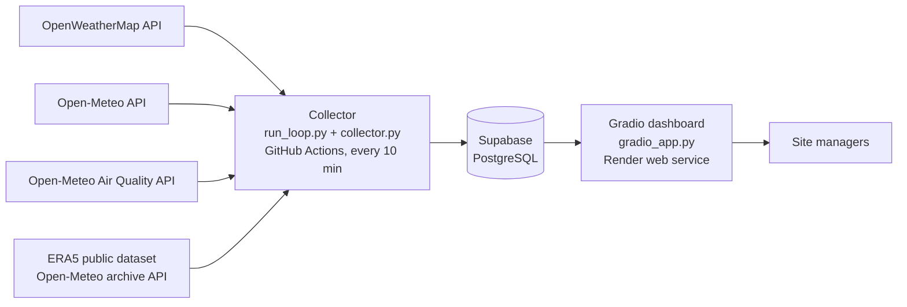

# Site Weather Risk Monitor · Vancouver, BC

A live dashboard that helps **construction site managers** make safe go/no-go decisions on site.
It combines live weather, air quality and a public historical dataset in one database, predicts the
temperature 10 minutes ahead, checks every prediction against what really happened, and **learns
from its own mistakes**.

**Live dashboard (Gradio):** https://site-weather-risk.onrender.com
*(Free hosting: if nobody has opened it for 15 minutes, the first load takes about 1 minute.)*

---

## Contents
1. [What the dashboard does](#1-what-the-dashboard-does)
2. [Architecture](#2-architecture)
3. [Data sources](#3-data-sources)
4. [Database design](#4-database-design)
5. [Prediction and self-correction](#5-prediction-and-self-correction)
6. [Repository structure](#6-repository-structure)
7. [Required libraries](#7-required-libraries)
8. [Setup: replicate the project](#8-setup-replicate-the-project)
9. [Configuration reference](#9-configuration-reference)
10. [Troubleshooting](#10-troubleshooting)
11. [Notes and attribution](#11-notes-and-attribution)

---

## 1. What the dashboard does

**Audience:** construction site managers in Vancouver.

**Decisions it supports** (limits are adjustable in the dashboard):

| Decision | Data used | Default limit |
|---|---|---|
| Pour concrete now? | Temperature + 10-minute prediction | below 5 °C |
| Run crane lifts? | Wind gusts | 15 m/s |
| Roofing, painting, exterior finishes? | Rain, humidity | 0.5 mm |
| Cold-stress breaks for crews? | Feels-like temperature (wind chill) | 0 °C |
| Limit heavy outdoor work? | US Air Quality Index | 100 |

**Tabs:**
- **Site conditions & actions:** status banner, live condition cards, and an *Alerts & recommended actions* table.
- **Explore the data:** date range, source and variable filters; live charts; a 30-day risk-hours analysis from the ERA5 public dataset.
- **Forecast accuracy & learning:** last check (predicted → actual → error → model updated), predicted vs. actual chart, and rolling error of the self-learning model vs. a frozen model vs. a no-change guess.
- **About:** audience, decisions, data sources and method.

The page refreshes itself every 60 seconds.

---

## 2. Architecture



Every 10 minutes the collector: **fetches** all live sources → **stores** them → **checks** the
prediction made 10 minutes earlier → **learns** from the error → **predicts** the next 10 minutes →
**saves** the model. The dashboard only reads from the database.

The collector runs on GitHub Actions. Each job loops for about 5.5 hours (one cycle every 10
minutes) and then starts the next job itself, because GitHub's own scheduler is unreliable on free
accounts. A backup schedule restarts it every 6 hours if the chain ever breaks.

---

## 3. Data sources

| Source | Type | What we use | Key needed |
|---|---|---|---|
| [OpenWeatherMap](https://openweathermap.org/current) | Live API | Temperature, humidity, pressure, wind, gusts, cloud, rain | Yes (free) |
| [Open-Meteo Forecast](https://open-meteo.com/en/docs) | Live API | Same variables from an independent model | No |
| [Open-Meteo Air Quality](https://open-meteo.com/en/docs/air-quality-api) | Live API (CAMS model) | PM2.5, PM10, US AQI, ozone, NO₂, CO | No |
| [ERA5 reanalysis](https://open-meteo.com/en/docs/historical-weather-api) via Open-Meteo archive | **Public dataset** | 30 days of hourly history (temperature, wind, gusts, rain, humidity…) | No |

Location: Vancouver, BC (49.2827, -123.1207). Change it with `LAT` / `LON`.

---

## 4. Database design

All data is stored in one **Supabase (PostgreSQL)** database. The full schema is in
[`schema.sql`](schema.sql).

| Table | One row per | Key columns |
|---|---|---|
| `readings` | weather source per 10-minute cycle | `ts`, `source`, `temperature`, `humidity`, `pressure`, `wind_speed`, `wind_gust`, `cloud_cover`, `precipitation` |
| `air_quality` | 10-minute cycle | `ts`, `pm2_5`, `pm10`, `us_aqi`, `ozone`, `nitrogen_dioxide`, `carbon_monoxide` |
| `history` | hour (ERA5 public dataset) | `ts` (primary key, so reloading never duplicates), weather columns, `dataset`, `loaded_at` |
| `predictions` | 10-minute forecast | `made_at`, `target_time`, `predicted_temp`, `frozen_temp`, `baseline_temp`, `actual_temp`, `error`, `frozen_error`, `baseline_error`, `features` (JSON inputs) |
| `model_state` | saved model | `id` (1 = self-learning, 2 = frozen), `model_b64` (pickled model), `n_learned` |

**Security:** row-level security is on. The dashboard uses the *publishable* key and can only read
`readings`, `air_quality`, `history` and `predictions`. Only the collector, using the *secret*
key, can write. `model_state` is not readable by the public.

---

## 5. Prediction and self-correction

- **Target:** the change in temperature over the next 10 minutes. Prediction = current temperature + predicted change (capped at ±1.5 °C).
- **Current temperature:** the average of the weather sources available in that cycle.
- **Model:** online linear regression from the [`river`](https://riverml.xyz) library:
  `StandardScaler → LinearRegression(SGD, learning rate 0.005, L2 0.001, gradient clipping 1.0)`.
- **Inputs (features):** temperature, humidity, pressure, wind speed, cloud cover, time of day
  (sine/cosine of the hour), temperature trend and pressure trend over the last cycle.
- **Warm start:** on first run the model is pre-trained on 30 days of hourly history (two passes).
- **Self-correction:** when the next cycle runs, the collector finds the prediction whose target
  time has arrived, records the actual temperature and the errors, and calls `learn_one()` with the
  inputs used at the time and the true change. The model updates after every check, with no
  retraining.

**Three predictions are scored for every cycle:**

| Model | Description |
|---|---|
| Self-learning model | Warm-started, then learns from every checked prediction |
| Frozen model | Warm-started the same way but **never learns**. It shows what learning adds |
| No-change guess | "The temperature in 10 minutes equals the temperature now". The minimum bar to beat |

When the frozen model is first created, it is also scored on every earlier prediction, using the
inputs saved with each one, so the comparison covers the whole history.

---

## 6. Repository structure

```
.
├── .github/workflows/main.yml   # GitHub Actions: runs the collector, restarts itself
├── collector.py                 # one cycle: fetch, store, check, learn, predict, save
├── run_loop.py                  # runs collector.py every 10 minutes (~5.5 h per job)
├── history.py                   # loads the ERA5 public dataset (30 days, hourly)
├── gradio_app.py                # the Gradio dashboard
├── schema.sql                   # complete database setup
├── requirements.txt             # libraries for the collector
├── requirements-gradio.txt      # libraries for the dashboard
├── .env.example                 # template for local settings
└── README.md
```

---

## 7. Required libraries

Python **3.10 or newer** (deployed with 3.11 on GitHub Actions and 3.12 on Render).

**Collector** ([`requirements.txt`](requirements.txt)):

| Library | Used for |
|---|---|
| `requests` | Calling the weather, air-quality and ERA5 APIs |
| `river` | Online machine learning (`learn_one` / `predict_one`) |
| `supabase` | Reading and writing the database |
| `python-dotenv` | Loading settings from `.env` when running locally |

**Dashboard** ([`requirements-gradio.txt`](requirements-gradio.txt)):

| Library | Used for |
|---|---|
| `gradio` (5.x) | The web dashboard and its controls |
| `supabase` | Reading the database |
| `pandas` | Data processing and calculations |
| `plotly` | Interactive charts |
| `tzdata` | Vancouver time-zone data |
| `python-dotenv` | Loading settings from `.env` when running locally |

---

## 8. Setup: replicate the project

You need free accounts on **Supabase**, **OpenWeatherMap**, and (for the cloud version)
**GitHub** and **Render**. No credit card is required.

### Step 1: Get the code
```bash
git clone https://github.com/imtiyaz1234/weather-dashboard.git
cd weather-dashboard
```
(For the cloud version, **fork** the repository on GitHub instead, so Actions and Render can use your copy.)

### Step 2: Create the database
1. Go to [supabase.com](https://supabase.com) → **New project** (any name, any region) and wait until it is ready.
2. Open **SQL Editor → New query**, paste the whole of [`schema.sql`](schema.sql) and click **Run**. You should see *Success. No rows returned*.
3. Open **Project Settings → API Keys** and copy:
   - the **Project URL** → `SUPABASE_URL`
   - the **secret** key (`sb_secret_…`) → used by the collector
   - the **publishable** key (`sb_publishable_…`) → used by the dashboard

### Step 3: Get a weather API key
Sign up at [openweathermap.org](https://openweathermap.org/api) (free plan) → **My API keys** →
copy the key. **New keys can take up to 2 hours to activate.** Until then the collector keeps
running with Open-Meteo only.

### Step 4 (option A): Run everything on your own computer
```bash
python -m venv .venv
# Windows: .venv\Scripts\activate      macOS/Linux: source .venv/bin/activate
pip install -r requirements.txt -r requirements-gradio.txt

cp .env.example .env        # Windows: copy .env.example .env
# edit .env: paste SUPABASE_URL, the SECRET key as SUPABASE_KEY, and OWM_API_KEY
```

Run **one** collection cycle to check the setup:
```bash
python history.py           # loads the 30-day ERA5 public dataset
python collector.py         # fetch, store, predict once
```
Expected output (numbers will differ):
```
[fetch] 2 source(s), fused temp 10.60°C
[air] PM2.5 7.9 µg/m³, US AQI 44
[model] new model, warm-started on 1460 historical samples
[frozen] created from 1462 historical samples (it will never learn)
[predict] in 10 min: 10.64°C (change +0.04) | frozen model: 10.62°C
[model] saved, live learning steps so far: 0
```

Keep collecting every 10 minutes (leave it running; stop with **Ctrl+C**):
```bash
python run_loop.py
```
From the second cycle on, each cycle also prints a `[check]` line: the prediction, the actual
value and the errors. That is the self-correction step.

Start the dashboard (in a second terminal, with the same `.env`):
```bash
python gradio_app.py
```
Open **http://localhost:7860**.

### Step 4 (option B): Run it in the cloud (as deployed)

**Collector on GitHub Actions**
1. In your fork: **Settings → Secrets and variables → Actions → New repository secret**, and add:
   `SUPABASE_URL`, `SUPABASE_KEY` (the **secret** key), `OWM_API_KEY`.
2. **Actions** tab → enable workflows if asked → **Weather collector → Run workflow**.
3. Open the run → **collect** → step *Collect every 10 minutes for about 5.5 hours* to see the
   log. The job runs for ~5.5 hours and then starts the next one automatically.

   To stop collecting: **Actions → Weather collector → ⋯ → Disable workflow**.

**Dashboard on Render**
1. [render.com](https://render.com) → sign in with GitHub → **New → Web Service** → select your fork.
2. Settings:

   | Setting | Value |
   |---|---|
   | Language | Python 3 |
   | Branch | `main` |
   | Root directory | *(empty)* |
   | Build command | `pip install -r requirements-gradio.txt` |
   | Start command | `python gradio_app.py` |
   | Instance type | **Free** |

3. Environment variables: `SUPABASE_URL`, `SUPABASE_KEY` (the **publishable** key), `PYTHON_VERSION` = `3.12.7`.
4. **Deploy web service.** When the log shows *Your service is live*, open the `.onrender.com` link.

The same `gradio_app.py` also runs on Hugging Face Spaces (Gradio SDK) if your account has
access to it. Add the two `SUPABASE_` values as Space secrets.

### Step 5: Check that it works
- Supabase **Table Editor**: `readings` gains 2 rows per cycle, `air_quality` 1 row, `history` ~720 rows.
- `predictions`: older rows get `actual_temp`, `error`, `frozen_error` and `baseline_error` filled in.
- The dashboard shows the status banner, alerts, charts and, after ~30 minutes, the error trend.

---

## 9. Configuration reference

| Variable | Used by | Required | Default | Meaning |
|---|---|---|---|---|
| `SUPABASE_URL` | collector, dashboard | yes | | Supabase project URL |
| `SUPABASE_KEY` | collector, dashboard | yes | | Collector: **secret** key. Dashboard: **publishable** key |
| `OWM_API_KEY` | collector | recommended | | OpenWeatherMap key (without it, Open-Meteo only) |
| `LAT`, `LON` | collector | no | 49.2827, -123.1207 | Site location |
| `LOOP_MINUTES` | run_loop.py | no | 340 | How long one loop runs before exiting |
| `INTERVAL_SECONDS` | run_loop.py | no | 600 | Time between cycles |
| `TIMEZONE` | dashboard | no | America/Vancouver | Time zone for displayed times |
| `LOCATION_NAME` | dashboard | no | Vancouver, BC | Name shown in the header |
| `PORT` | dashboard | no | 7860 | Web port (set automatically by Render) |

---

## 10. Troubleshooting

| Problem | Fix |
|---|---|
| `KeyError: 'SUPABASE_URL'` | `.env` missing or misspelled, or the GitHub secret is missing |
| `new row violates row-level security` | The collector is using the publishable key. Use the **secret** key |
| `[warn] fetch_openweathermap failed: 401` | OpenWeatherMap key not active yet. Wait up to 2 hours |
| Dashboard says *Missing settings* | Add `SUPABASE_URL` and `SUPABASE_KEY` as environment variables |
| Dashboard says *No readings in this date range* | The collector hasn't run yet, or pick a longer date range |
| Error-trend chart is empty | Needs at least 3 checked predictions (about 30 minutes) |
| GitHub run stuck on *Queued* | Another collector run is still going. Only one runs at a time |
| Render shows the old version | Wait for the deploy to finish, then reload the page with Ctrl+Shift+R |

---

## 11. Notes and attribution

- **Hosting:** Hugging Face Spaces requires a paid plan for Gradio Spaces on new accounts (since
  July 2026), so the Gradio dashboard is hosted on Render's free tier, with the instructor's approval.
- **Alert limits** are adjustable starting points, not engineering or safety advice. Always follow
  equipment manuals, product data sheets and WorkSafeBC requirements.
- **Data:** weather data by [Open-Meteo](https://open-meteo.com) (CC BY 4.0) and
  [OpenWeather](https://openweathermap.org). ERA5: Hersbach et al. (2023), generated using
  Copernicus Climate Change Service information. Air quality: CAMS via Open-Meteo.
